<div align="center">

# LowSYS

**A distillation column you can break on purpose.**

*It's HYSYS, but low. Low cost (free). Low stakes (nobody gets fired). Low key the best way to finally get McCabe-Thiele.*

[](LICENSE)


[**Download**](../../releases/latest) · [What you'll learn](#what-youll-learn) · [Install](#install) · [For instructors](#for-instructors) · [Themes](#pick-your-vibe)

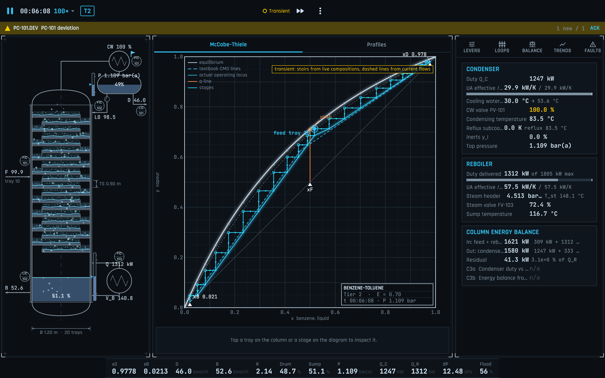

<sub>Control Room theme, six minutes into a run, already one alarm deep. Situation: normal.</sub>

<sub>LowSYS is an independent student project, not affiliated with AspenTech. See [Trademarks](#trademarks).</sub>

</div>

## What is this

LowSYS is a free, interactive distillation column simulator built for learning. You get a live column, a live McCabe-Thiele diagram that redraws itself as the column moves, and a pile of levers. Push reflux, starve the reboiler, flood the trays, then watch exactly *why* things went sideways, down to the equation.

It goes from vapour-liquid equilibrium on a single tray up to full column behaviour: tray and packed hydraulics, control loops, alarms, faults, azeotropes, a multicomponent debutanizer and a crude unit, plus guided scenarios and hidden-fault drills.

Textbooks show you a column at steady state. Real columns are never at steady state. LowSYS lets you feel the difference without anyone setting a real one on fire.

**Why students use it**

- **It shows its work.** Tap a tray and the math overlay traces the equations that produced every number on screen.
- **It's honest about the physics.** Three thermodynamic tiers, from textbook constant-alpha up to NRTL, so you can see exactly what the simplifying assumptions hide (and when they lie to you).
- **Breaking it is the point.** Inject a fault in the sandbox, or let a drill hide one and play detective with noisy instruments, like an actual plant.
- **It runs on your phone.** Every layout works from a 360 px portrait phone up to a desktop. Study in the bus. Flood a column in the dining hall.
- **It costs nothing, forever.** AGPL-licensed, so no one can ever paywall it. Not even us.

## Your first ten minutes

1. [Install it](#install) (about two minutes, most of which is clicking past an "unrecognised app" warning).
2. Open **Learn** and play **G1, Meet the column**. Watch it reach steady state and find the feed tray on the McCabe-Thiele diagram.
3. Play **G2, Minimum reflux**. Lower the reflux until the column can't hold its purity anymore. That pinch at the q-line? That's R_min. You just derived it with your hands.
4. Open the **Sandbox**, crank the feed rate, and watch the trays flood. Back it off before the flood % goes red.
5. Feeling sigma? Try a **Diagnose** drill. Something is broken. The game won't tell you what.

## What you'll learn

Sixteen guided scenarios, each with a briefing, objectives, hints, a score and a debrief. They line up with what a separations or unit-ops course covers.

| Course topic | Scenarios |
|---|---|
| McCabe-Thiele, stages, feed tray | G1 Meet the column, G5 Where to feed |
| Minimum reflux, total reflux, Fenske | G2 Minimum reflux, G3 Total reflux and Fenske |
| Feed condition and the q-line | G4 The q-line |
| Tray efficiency | G6 Real trays (Murphree) |
| Energy balances, constant molar overflow | G7 What CMO hides |
| Pressure and relative volatility | G8 Pressure and volatility |
| Azeotropes and non-ideal VLE | G9 The azeotrope wall, G10 The other azeotrope |
| Tray hydraulics: flooding and weeping | G11 Flooding, G12 Turndown and weeping |
| Multicomponent shortcut design (FUG) | G13 Debutanizer keys and FUG |
| Reboilers and thermosyphon stability | G14 Thermosyphon tuning |
| Packed columns, HETP, pressure drop | G15 Packing retrofit |
| Crude fractionation, cut points and gaps | G16 Crude cut points and gaps |

Then there are the **ten hidden-fault drills** (H1 to H10). The game picks one fault at random from a list, hides it, and turns on measurement noise. You get the plant's instruments, the levers and your brain. Diagnose the category and location before product goes off-spec. Some drills include a decoy where nothing is broken and the feed just changed, so jumping to conclusions costs points. Two of them, *Don't trust the gauge* and *Bad valve or bad meter?*, are about instruments that lie, which is the most real-plant lesson in here.

There's also a **Library** of short concept cards (minimum reflux, weeping, azeotropes and more), each linked to the scenario that demonstrates it.

<table>
<tr>
<td width="50%">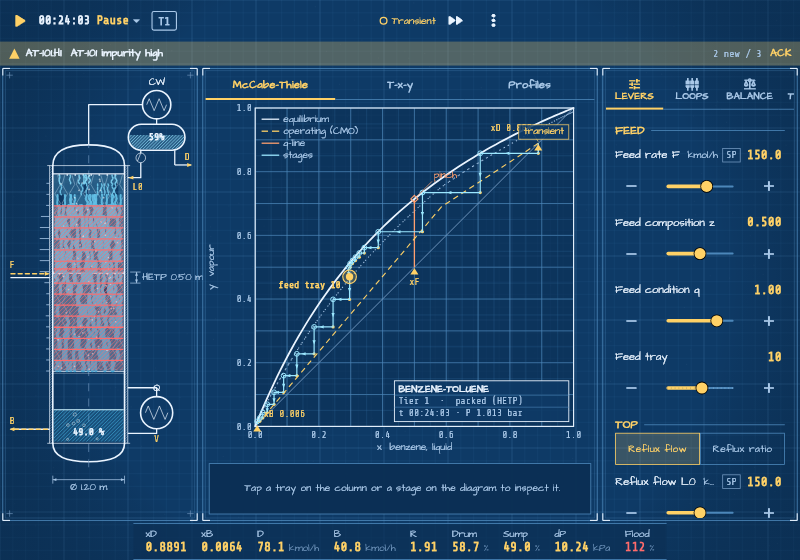</td>
<td width="50%">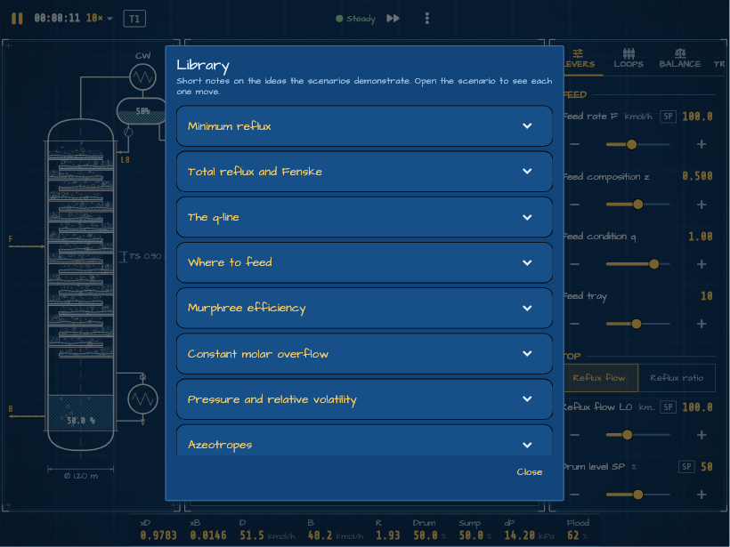</td>
</tr>
<tr>
<td><sub>Packed column at 112 % of flood. The column is cooked. Back off the feed.</sub></td>
<td><sub>The Library: the lore drop for every scenario.</sub></td>
</tr>
<tr>
<td>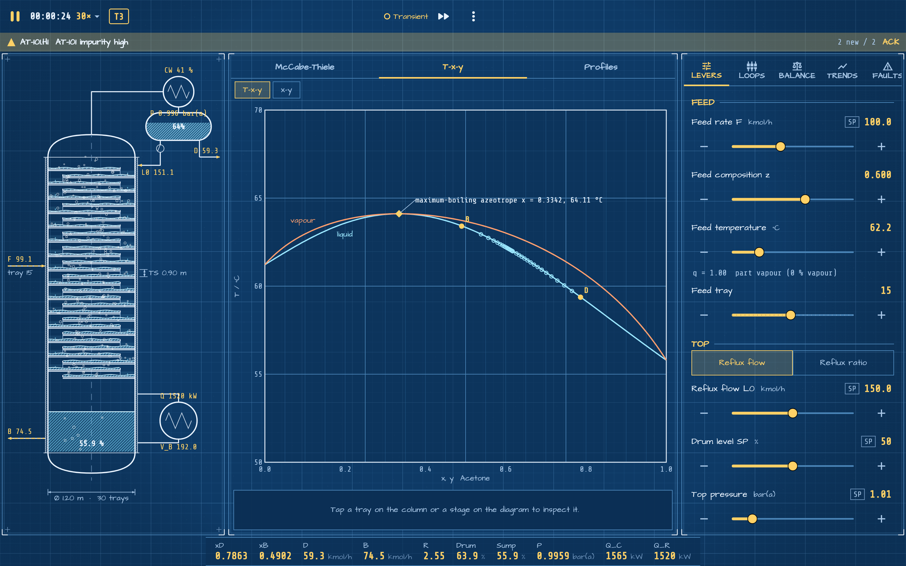</td>
<td>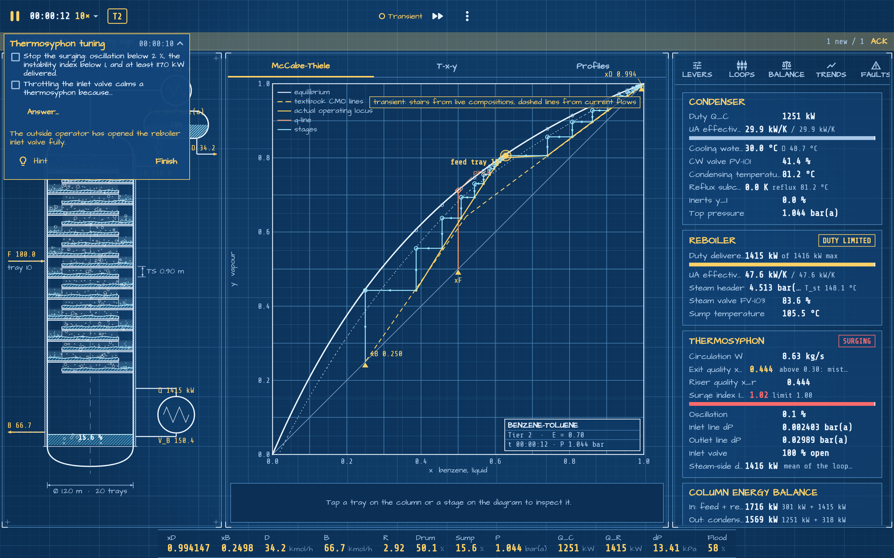</td>
</tr>
<tr>
<td><sub>Acetone-chloroform. The azeotrope that refuses to leave out the top.</sub></td>
<td><sub>Thermosyphon tuning. The reboiler is surging and it's your problem now.</sub></td>
</tr>
</table>

## Pick your vibe

Six themes, all drawing the same physics. Switch any time in Settings.

<table>
<tr>
<td width="50%">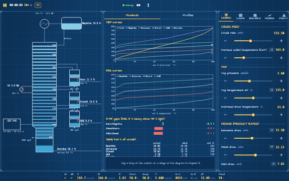<br><sub><b>Blueprint</b>: drafting table energy. Hand-ruled grids, hatched liquid, pencil-yellow highlights.</sub></td>
<td width="50%">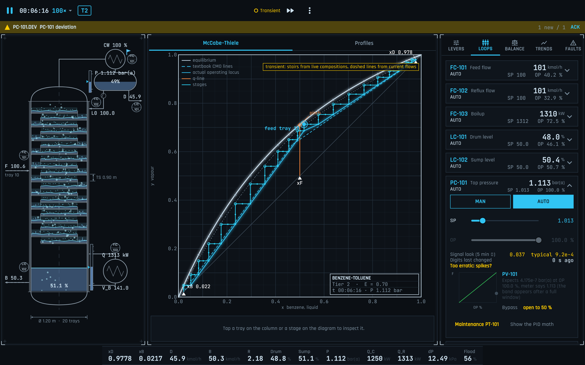<br><sub><b>Control Room</b>: DCS night shift. Follows ISA-101, so colour only shows up when something is wrong.</sub></td>
</tr>
<tr>
<td>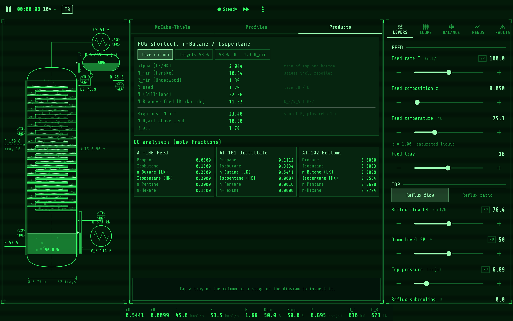<br><sub><b>Phosphor</b>: green-screen terminal. Your column, but make it 1983.</sub></td>
<td>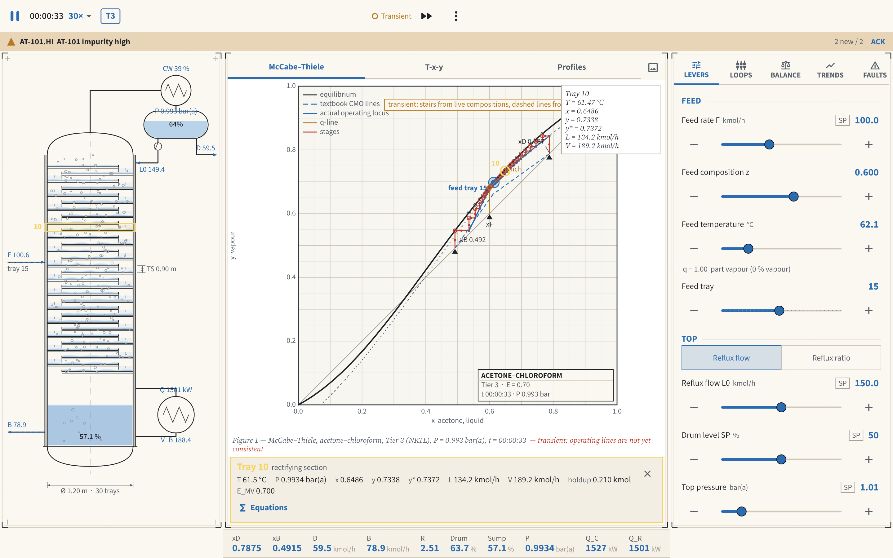<br><sub><b>Paper</b>: looks like the textbook figure, except it moves.</sub></td>
</tr>
<tr>
<td>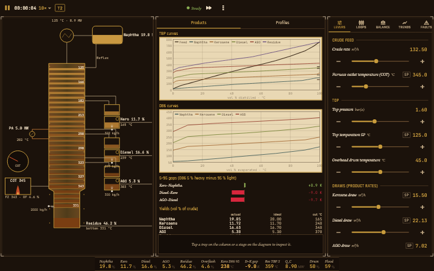<br><sub><b>Brass</b>: steampunk refinery. Gauges with main character energy.</sub></td>
<td>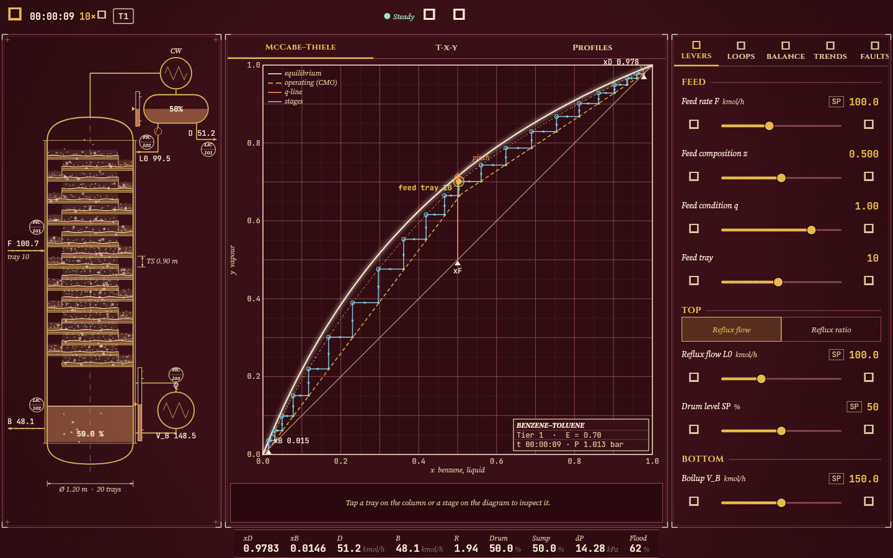<br><sub><b>SPD</b>: red and gold. Dressed for the occasion.</sub></td>
</tr>
</table>

Blueprint, Control Room and Paper were tuned to pass a colour-blind safety check, so the important colours stay distinct for everyone.

## Install

Download the file for your device from the [Releases page](../../releases/latest). None of the builds are code-signed by Apple, Microsoft or Google, so each system shows a one-time warning the first time you open the app. The steps below get past it.

| Device | File |
|---|---|
| Windows 10/11 (64-bit) | `LowSYS-windows-x64.zip` |
| macOS (Apple silicon and Intel) | `LowSYS-macos.dmg` (or `LowSYS-macos.zip`) |
| Linux (64-bit, GTK 3) | `LowSYS-linux-x64.tar.gz` |
| Android | `LowSYS-android.apk` |
| iPhone / iPad | `LowSYS-ios-unsigned.ipa` (sideload, see below) |

### Windows

1. Right-click `LowSYS-windows-x64.zip` and choose **Extract All**. Keep the files together; the app does not run from inside the zip.
2. Open the extracted folder and run `lowsys_app.exe`.
3. If Windows shows "Windows protected your PC", click **More info**, then **Run anyway**.

### macOS

1. Open `LowSYS-macos.dmg` and drag `lowsys_app` into **Applications**.
2. The first time, Control-click (or right-click) the app and choose **Open**, then **Open** again. If macOS only offers to move it to the Bin, try to open it once, then go to **System Settings > Privacy & Security** and click **Open Anyway**.
3. Alternatively, in Terminal: `xattr -dr com.apple.quarantine /Applications/lowsys_app.app`

Exported figures are saved to your Downloads folder.

### Linux

```sh
mkdir LowSYS && tar -xzf LowSYS-linux-x64.tar.gz -C LowSYS
./LowSYS/lowsys_app
```

It needs GTK 3, which most desktops already have (`sudo apt install libgtk-3-0` on Debian/Ubuntu if not). Saves go to `~/.local/share/LowSYS`.

### Android

1. Download `LowSYS-android.apk` on the phone and tap it.
2. When Android asks, allow your browser or file manager to **install unknown apps**, then go back and tap **Install**.
3. If Play Protect warns about an unrecognised app, tap **More details**, then **Install anyway**.

When updating, if Android refuses to install over an older copy, uninstall the old one first (builds from different machines are signed with different keys).

### iPhone and iPad

Apple only lets apps from the App Store or a paid developer account install by tapping, so the `.ipa` has to be sideloaded with a free Apple ID:

1. Install [AltStore](https://altstore.io) or [Sideloadly](https://sideloadly.io) on a Mac or PC.
2. Connect the iPhone, add `LowSYS-ios-unsigned.ipa` in the tool, and sign in with your Apple ID.
3. On the iPhone, go to **Settings > General > VPN & Device Management** and trust your Apple ID. On iOS 16 and later, also turn on **Settings > Privacy & Security > Developer Mode**.

With a free Apple ID the app must be re-signed every 7 days (AltStore can refresh it automatically). Building it yourself in Xcode (below) has the same limit.

## Build from source

All platforms need [Flutter](https://docs.flutter.dev/get-started/install) 3.47.7 (stable) and git.

```sh
git clone https://github.com/HearthOfEmbers/LowSYS.git
cd LowSYS/app
flutter pub get
```

| Platform | Extra tools | Build command | Output |
|---|---|---|---|
| Windows | Visual Studio 2022 with "Desktop development with C++" | `flutter build windows --release` | `app/build/windows/x64/runner/Release/` |
| macOS | Xcode | `flutter build macos --release` | `app/build/macos/Build/Products/Release/lowsys_app.app` |
| Linux | `sudo apt install clang cmake ninja-build pkg-config libgtk-3-dev` | `flutter build linux --release` | `app/build/linux/x64/release/bundle/` |
| Android | Android Studio (SDK) and JDK 17 | `flutter build apk --release` | `app/build/app/outputs/flutter-apk/app-release.apk` |
| iOS | Xcode and an iPhone | `open ios/Runner.xcworkspace`, set **Signing & Capabilities > Team** to your Apple ID, pick your iPhone, Run | installed on the device |

`flutter run` starts a debug build on whatever device is connected.

Tests:

```sh
cd packages/lowsys_engine && dart test   # engine and validation suite
cd app && flutter test                   # app tests (golden images are made on Windows)
```

### Making a release

Every pull request builds all five platforms in GitHub Actions ([`.github/workflows/release.yml`](.github/workflows/release.yml)); the files are on the run's summary page. Pushing a tag such as `v0.1.0` also publishes them as a GitHub Release.

## For instructors

LowSYS is built to be assigned.

- **Every scenario is scored** (objectives, time, safety and product quality) and ends with a debrief, so "play G4 and screenshot your debrief" is a complete homework question.
- **Drills are seeded and graded.** Students submit a diagnosis and get a score for category, location and time. Wrong guesses cost points, so they have to reason from evidence.
- **Numbers are checked against the literature.** [docs/VALIDATION.md](docs/VALIDATION.md) lists the test cases, reference values and tolerances, and the engine's test suite runs them.
- **The model is fully documented.** [docs/PHYSICS.md](docs/PHYSICS.md) has every equation, which makes it a decent companion reading for a separations course.
- **Write your own.** Scenarios and drills are plain JSON. [docs/EXTENDING.md](docs/EXTENDING.md) shows how to add scenarios, drills, faults, column presets and themes for your course.
- **No accounts, no licences, no IT ticket.** Students download it and run it on whatever they own, phones included.

## Contributing and extending

Found a bug, a wrong number or a confusing hint? Open an issue. Want to add something? [docs/EXTENDING.md](docs/EXTENDING.md) explains how to add themes, scenarios and drills, column presets, faults, levers, components and panels, with the files to change and the tests to run.

## Specification

| Document | Contents |
|---|---|
| [docs/SCOPE.md](docs/SCOPE.md) | Feature scope, screens and layouts, levers, fault catalog, scenarios and drills, themes, milestone plan with acceptance criteria |
| [docs/PHYSICS.md](docs/PHYSICS.md) | Full mathematical model: thermodynamic tiers, stage dynamics, tray and packing hydraulics, condenser/reboiler/thermosyphon, crude, controllers, faults, numerical scheme |
| [docs/ENGINE_API.md](docs/ENGINE_API.md) | Repository layout, pure-Dart engine API, snapshots, explain API, faults, control, scenarios, units, Flutter app architecture and theme tokens |
| [docs/VALIDATION.md](docs/VALIDATION.md) | Test cases with reference numbers and tolerances |

## License

LowSYS is licensed under the [GNU Affero General Public License v3.0 or later](LICENSE).

In short: anyone may use, study, change and share LowSYS for free, including in classes and courses. If someone distributes a modified version, or runs one as a website or online service, they must release their full source code under the same license. That keeps every version of LowSYS open, so nobody can turn it into a closed, paywalled product.

The physical property data and correlations come from the published literature cited in [docs/PHYSICS.md](docs/PHYSICS.md) §17. The bundled fonts are under the SIL Open Font License 1.1; their license texts are in [app/assets/fonts/LICENSES](app/assets/fonts/LICENSES).

## Trademarks

LowSYS is an independent, free teaching project. Its name is an affectionate nod to Aspen HYSYS, but LowSYS is not affiliated with, endorsed by, or sponsored by Aspen Technology, Inc., and contains no code, data or artwork from HYSYS. HYSYS and Aspen HYSYS are trademarks of Aspen Technology, Inc.
